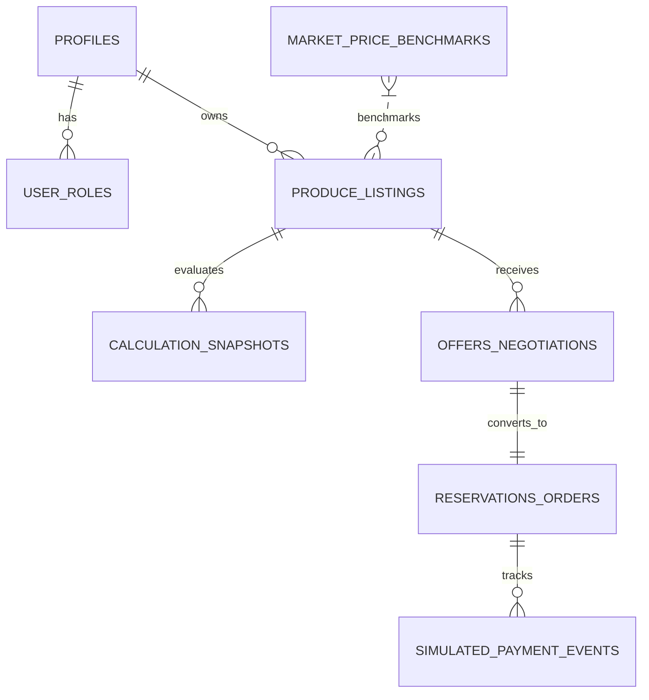

# AgriPrice System Architecture & Database Design Proposal
**Module:** From Produce to Profit (Foundation & Calculation Engine)  
**Version:** v1.0.0-proposal  
**Security Level:** Row-Level Security (RLS) Enforced, Multi-Tenant Role Isolation  

---

## 1. Executive Summary & Domain Scope

AgriPrice is a deterministic agricultural pricing and net-proceeds realization platform designed to give farmers, farmer producer organizations (FPOs), traders, and food processors transparent foresight into their post-harvest realization before committing produce to transit or auction.

### Core Principle: Net Proceeds vs. Farm Profit
A foundational rule of AgriPrice is **strict financial transparency**:
- **Gross Revenue**: `Sellable Quantity (kg) × Realized Market Price (₹/kg)`.
- **Estimated Net Proceeds**: `Gross Revenue − Total Post-Harvest Intermediary Deductions` (transportation, labor handling, commission fees, storage, packaging, statutory cess).
- **Net Farm Profit**: `Estimated Net Proceeds − In-Field Cultivation Expenses` (seeds, fertilizer, agrochemicals, irrigation, tractor hire, in-field labor).
**Guaranteed System Rule**: Net Proceeds must **never** be labeled or represented as "Profit" unless pre-harvest cultivation costs are explicitly supplied by the producer.

---

## 2. Multi-Role RBAC Model

The system accommodates 5 primary actor roles:
1. **Producer / Farmer (`farmer`)**: Lists produce, runs proceeds calculations, compares selling channels, receives purchase offers.
2. **Trader / Commission Agent (`trader`)**: Views public listings, benchmarks wholesale prices, issues buying bids/offers.
3. **Agro-Processor / Bulk Buyer (`processor`)**: Issues direct-procurement contracts with farmgate pickup and zero commission.
4. **FPO Administrator (`fpo_admin`)**: Aggregates produce across multiple member farmers, negotiates institutional bulk sales.
5. **Transporter / Logistics Partner (`transporter`)**: Submits haulage bids, tracks perishable transit conditions.
6. **Platform Auditor / Admin (`admin`)**: Inspects immutable calculation audit trails and benchmarks.

---

## 3. Database Entity Relationship Model



---

## 4. Row-Level Security (RLS) Policy Matrix

| Table | SELECT Policy | INSERT Policy | UPDATE Policy | DELETE Policy |
| :--- | :--- | :--- | :--- | :--- |
| `profiles` | Public read for active verified users; full read for self. | Self only upon auth registration. | Self only (cannot elevate role). | Self or Admin. |
| `user_roles` | Authenticated users can view their own assigned roles. | Admin only. | Admin only. | Admin only. |
| `produce_listings` | Public read for `ACTIVE` listings; draft listings visible only to owner. | Farmers and FPO Admins only. | Owner only if status is `DRAFT` or `ACTIVE` (no active escrow orders). | Owner only (soft-delete / archive). |
| `market_price_benchmarks` | Public read for all authenticated and anonymous users. | Admin / Ingestion Cron only. | Admin only. | Admin only. |
| `calculation_snapshots` | Owner only (farmer who performed the calculation); linked buyer if attached to offer. | Authenticated users (immutable record). | Disallowed (Strictly Immutable Audit Trail). | Disallowed. |
| `offers_negotiations` | Listing owner (seller) and offer creator (buyer). | Verified Traders and Processors. | Parties involved while in `PENDING` or `COUNTERED`. | Disallowed once submitted. |
| `reservations_orders` | Order buyer, seller, and assigned transporter. | Triggered upon offer acceptance. | Buyer/Seller/Transporter based on state transition. | Disallowed (Cancellation state only). |
| `simulated_payment_events` | Order buyer, seller, and platform admin. | Secure backend ledger function only. | Disallowed (Append-Only Event Ledger). | Disallowed. |

---

## 5. Idempotent Simulated Payment Events & Escrow Workflow

To prevent phantom transactions or nonfunctional buttons:
1. All payments in the architecture are modeled as an **Append-Only Event Log** (`simulated_payment_events`).
2. Event types:
   - `ESCROW_FUNDS_AUTHORIZED`: Buyer authorizes payment hold upon order placement.
   - `DISPATCH_CONFIRMED`: Transporter confirms physical loading at farmgate.
   - `DELIVERY_ACCEPTED`: Buyer conducts quality inspection and accepts grade.
   - `FUNDS_RELEASED`: Net proceeds disbursed to farmer bank account; commission & transport fees paid to respective partners.
   - `REFUND_ISSUED`: In the event of catastrophic transit loss or buyer rejection.
3. Every payment event includes an `idempotency_key` and cryptographic SHA-256 payload hash to prevent double-charging or race conditions.

---

## 6. Environment Variables Contract (`.env.example`)

All external integrations must be decoupled behind environment variables:
```bash
# Application Mode
NEXT_PUBLIC_APP_ENV="demo"
NEXT_PUBLIC_CALCULATION_ENGINE_VERSION="v1.0.0-deterministic"

# Future Live Mandi Integrations (Agmarknet / e-NAM)
AGMARKNET_API_KEY=""
AGMARKNET_BASE_URL="https://api.data.gov.in/resource/"

# Future Database Connection (PostgreSQL / Supabase)
DATABASE_URL=""
SUPABASE_URL=""
SUPABASE_ANON_KEY=""
SUPABASE_SERVICE_ROLE_KEY=""

# Future Escrow / Payment Simulation Gateway
PAYMENT_GATEWAY_WEBHOOK_SECRET=""
```
